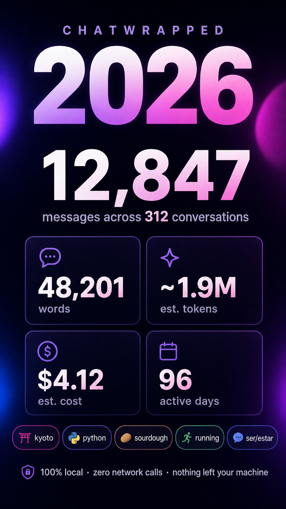

# ChatWrapped

**Spotify Wrapped for your AI chats.** One local command turns your official
ChatGPT / Claude / Gemini data exports into a shareable year-in-review — a
terminal summary, a self-contained HTML story page, a downloadable 1080×1920
share card, and a JSON stats file.

[](https://pypi.org/project/chatwrapped/)
[](LICENSE)
[](https://pypi.org/project/chatwrapped/)
[](#privacy)



> A live, real (synthetic-data) report is committed at
> [`demo/wrapped/index.html`](demo/wrapped/index.html) — open it in a
> browser. A recorded demo GIF is on the roadmap (vhs); until then, this
> static card shows the vibe.

---

## Quick start (3 steps)

**1. Export your data** from each platform you use — exact click-paths in
[docs/export-guide.md](docs/export-guide.md):

| Platform | Where | What you get |
|---|---|---|
| ChatGPT | chatgpt.com → profile → **Settings → Data controls → Export** | `.zip` (nested `Conversations__*-chatgpt-0001.zip`) or legacy `conversations.json` |
| Claude | claude.ai → profile → **Settings → Privacy → Export data** | `.zip` with `conversations-000.zip` |
| Gemini | takeout.google.com → select **Gemini** → Create export | Takeout archive (experimental) |

**2. Run one command** (no install needed):

```bash
uvx chatwrapped build ~/Downloads/*export*.zip ~/Downloads/Takeout --open
# or with pipx:
pipx install chatwrapped
chatwrapped build ~/Downloads/*export*.zip -o wrapped/ --year 2026 --open
```

Multiple exports at once are merged and deduplicated automatically.

**3. Share your card.** The report ends with a 1080×1920 share card —
download it as **PNG** or **SVG** straight from the page.

Outputs land in `wrapped/` (override with `-o`):

```
wrapped/
├── index.html       # self-contained story page (inline CSS/JS, no CDN)
├── share-card.svg   # the 1080x1920 card
└── stats.json       # full stats for power users
```

### Useful flags

```bash
chatwrapped scan <paths...>              # inspect + validate exports first
chatwrapped build <paths...> --year 2026 # just one year
chatwrapped build <paths...> --redact    # mask message excerpts in the report
chatwrapped build <paths...> --json      # print full stats JSON to stdout
chatwrapped build <paths...> --open      # open the HTML report in your browser
chatwrapped config                       # show/edit model rates + default year
chatwrapped config set rate gpt-4o 2.5 10.0
chatwrapped config set year 2026
```

## What you get

- **Totals** — conversations, messages (you vs. AI), words, estimated tokens
  (chars/4) and estimated cost at configurable per-model rates
  (`chatwrapped config`).
- **Activity** — monthly rhythm, a GitHub-style year heatmap, busiest day,
  active days, average messages per active day, and your latest-night
  message ("you messaged at 3:47 AM").
- **Topics** — top-20 keywords/phrases via TF-IDF over your prompts, plus
  month-by-month themes ("your March was all about *asyncio*").
- **Milestones** — first-ever conversation (with the first prompt), longest
  chat, most-edited prompt, model breakdown with per-model cost.
- **Three outputs** — colored terminal table, the HTML story, and JSON.

## Privacy

**ChatWrapped never makes a network call.** Everything is parsed locally from
files you exported yourself:

- ✅ reads only the files/dirs you pass on the command line (zip members are
  read in-memory; nothing is uploaded anywhere);
- ✅ standard library only (`json`, `zipfile`, `html`, `argparse`,
  `pathlib`, `statistics`, `re`, `datetime`) — audit it, it's small;
- ✅ every run prints: *"Privacy: everything was parsed locally on this
  machine. ChatWrapped makes zero network calls — nothing left your device."*
- ✅ `--redact` masks all message excerpts in the HTML/JSON/terminal output
  (stats are still computed from the full text, locally);
- ❌ no accounts, no API keys, no telemetry, no scraping, no LLM calls.

Where is your data? Only in the export files you downloaded, and in the
`wrapped/` folder the tool writes on your machine.

## FAQ

**Does it upload anything?** No. Zero network calls, by design and by
construction (stdlib only, no HTTP client is ever invoked).

**Which platforms are supported?** ChatGPT (legacy `conversations.json` and
the newer nested-zip "User Online Activity" export), Claude
(`conversations-000.zip` + projects/memories), and Google Gemini via Takeout
(experimental, best-effort). Adding a platform = one new file in
`chatwrapped/parsers/` behind a common interface with fixture tests.

**How accurate is the cost estimate?** It's an estimate only: tokens are
approximated as chars/4, user messages are priced at the model's input rate
and assistant replies at the output rate from `rates.json` (editable via
`chatwrapped config set rate <model> <in> <out>`). Real billing depends on
your plan, caching, and the date.

**My export isn't detected.** Run `chatwrapped scan <path>` — it prints which
format it recognized per file and warns about anything skipped. Open an issue
with the file/folder *structure* (never paste your chats).

**Can I merge exports from different months?** Yes — pass them all to one
`build` command; conversations are deduplicated by platform + conversation id
and the most recent version of each message wins.

**Does it work offline?** Completely — it never touches the network.

## Development

```bash
git clone https://github.com/pooria683/ChatWrapped.git
cd ChatWrapped
python -m venv .venv && .venv/bin/pip install -e .[test]
.venv/bin/pytest                 # parser + stats + render + CLI tests
python examples/make_demo.py     # regenerate the synthetic demo exports
python -m chatwrapped build demo/exports -o demo/wrapped --year 2026 --open
```

Layout:

```
chatwrapped/
├── chatwrapped/
│   ├── cli.py            # argparse entry: scan / build / config
│   ├── merge.py          # dedupe + unified timeline
│   ├── stats.py          # all metric computations
│   ├── topics.py         # TF-IDF keywords/phrases
│   ├── rates.json        # editable per-model pricing
│   ├── render/           # terminal.py, html_story.py, share_card.py, template
│   └── parsers/          # base.py + one module per platform
├── tests/                # fixtures + golden tests (pytest)
├── examples/make_demo.py # synthetic demo export generator
└── wrapped_template.html # story template (kept in sync with the packaged copy)
```

## Roadmap

- [ ] Perplexity / Poe / Copilot / Cursor exports
- [ ] Demo GIF recorded with [vhs](https://github.com/charmbracelet/vhs) +
      export click-path screenshots
- [ ] MCP server mode so coding agents can search *your* local history
- [ ] Year-over-year diff ("Wrapped vs. last year")
- [ ] More share-card themes

## Contributing & launch

MIT licensed — PRs welcome. Planned launch: Show HN ("Show HN: ChatWrapped –
Spotify Wrapped for your AI chats"), an X thread with wrapped cards, a
r/ChatGPT post, and a pinned "share your wrapped" discussion issue.

GitHub topics: `ai`, `chatgpt`, `claude`, `wrapped`, `data-export`,
`local-first`, `cli`, `python`.

---

*Built for Wrapped season, December 2026. Your chats, your machine.*
